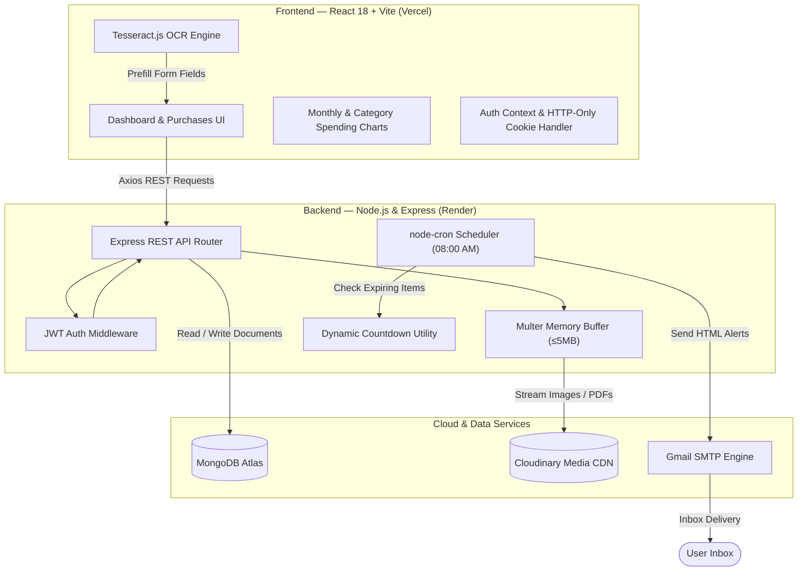

# 🛡️ ExpiryMate — Full-Stack Receipt & Warranty Tracker

<div align="center">


[](https://expiry-mate-snowy.vercel.app)
[](https://expirymate-0xvs.onrender.com)
[](https://github.com/riadhh-302005/ExpiryMate)


**A modern, production-deployed MERN application that stores purchase receipts, tracks return deadlines and warranty expirations with live countdowns, visualizes expenses in Indian Rupees (₹), and sends automated email reminders.**

[Explore Live Demo](https://expiry-mate-snowy.vercel.app) · [Report Bug](https://github.com/riadhh-302005/ExpiryMate/issues) · [Request Feature](https://github.com/riadhh-302005/ExpiryMate/issues)

</div>

---

## 📌 Table of Contents
1. [The Problem & Solution](#-the-problem--solution)
2. [Key Features](#-key-features)
3. [System Architecture](#-system-architecture)
4. [Tech Stack](#-tech-stack)
5. [Live Links & Demo Account](#-live-links--demo-account)
6. [Local Installation & Setup](#-local-installation--setup)
7. [Environment Variables](#-environment-variables)
8. [Sample Test Data & Receipts](#-sample-test-data--receipts)
9. [REST API Documentation](#-rest-api-documentation)
10. [Key Engineering & Architecture Decisions](#-key-engineering--architecture-decisions)
11. [Interview Revision Cheat Sheet](#-interview-revision-cheat-sheet)

---

## 💡 The Problem & Solution

Every year, consumers lose thousands of rupees because they:
- **Misplace paper receipts** or delete confirmation emails.
- **Forget return deadlines** (usually only 7–14 days) and get stuck with items they don't want.
- **Let manufacturer warranties lapse** right before a gadget breaks, paying out-of-pocket for costly repairs.

**ExpiryMate** solves this with a centralized, automated digital filing system that:
1. Backs up physical receipt photos or PDF invoices to Cloudinary.
2. Calculates dynamic, real-time countdown badges (e.g., `Return window open (3d left)`, `Warranty active (360d)`).
3. Automatically scans for impending deadlines every morning at 08:00 AM and emails users before it's too late.
4. Provides in-browser OCR (Optical Character Recognition) to extract store names, bill totals, and dates from receipts without manual typing.

---

## ✨ Key Features

- **🔐 Secure JWT Authentication**: User signup and login with `bcryptjs` password hashing and secure HTTP-only cookies (`SameSite: None`, `Secure`).
- **🧾 Complete Purchase Management (CRUD)**: Create, view, edit, and delete purchases with receipt image or PDF attachments (up to 5MB).
- **⏱️ Live Dynamic Countdowns**: Real-time remaining day math calculated on the fly without storing stale countdown numbers in MongoDB.
- **🔍 Multi-Criteria Search & Filtering**: Live search by product name or store, category dropdown, warranty status filter, and sort by price, date, or expiry.
- **📊 Financial Analytics Dashboard**: Built with **Recharts** to visualize 6-month spending trends and category proportions in Indian Rupees (`₹`).
- **🔔 Automated Cron Email Alerts**: Scheduled `node-cron` background worker executing daily at 08:00 AM with Nodemailer and duplicate alert prevention.
- **👁️ In-Browser OCR Scanner**: Powered by **Tesseract.js** to read text from receipt photos on the client side without paid external AI API keys.
- **☁️ Cloud Media Storage & Auto-Cleanup**: Streams uploads to Cloudinary and automatically deletes cloud assets when items are deleted.

---

## 🏗️ System Architecture



---

## 🛠️ Tech Stack

### Frontend
- **Library/Bundler**: React 18 with [Vite](https://vitejs.dev/)
- **Routing**: React Router DOM (v6)
- **Styling**: Tailwind CSS
- **Icons**: Lucide React
- **Charts**: Recharts (Responsive BarChart & Donut PieChart)
- **OCR Engine**: Tesseract.js (Client-side WebAssembly)
- **HTTP Client**: Axios with `withCredentials: true`

### Backend
- **Runtime**: Node.js
- **Framework**: Express.js
- **Database**: MongoDB with Mongoose ODM
- **Authentication**: JSON Web Tokens (`jsonwebtoken`) & `bcryptjs`
- **File Uploads**: Multer with memory storage
- **Cloud Storage**: Cloudinary SDK (with local disk fallback)
- **Job Scheduler**: `node-cron`
- **Email Delivery**: Nodemailer via Gmail SMTP

### Cloud & Deployment
- **Frontend Hosting**: Vercel
- **Backend Hosting**: Render.com Web Service
- **Database Hosting**: MongoDB Atlas (Free M0 Cluster)
- **Media Hosting**: Cloudinary

---

## 🌐 Live Links & Demo Account

| Component | URL |
| :--- | :--- |
| **Live Web App** | **[https://expiry-mate-snowy.vercel.app](https://expiry-mate-snowy.vercel.app)** |
| **Live Backend API** | **[https://expirymate-0xvs.onrender.com](https://expirymate-0xvs.onrender.com)** |
| **GitHub Repository** | **[https://github.com/riadhh-302005/ExpiryMate](https://github.com/riadhh-302005/ExpiryMate)** |

> **Pre-loaded Demo Account (if seeded)**:  
> **Email**: `aarav.sharma@example.com`  
> **Password**: `password123`  
> *(Or click "Create an account" to register your own isolated account in seconds).*

---

## 💻 Local Installation & Setup

### Prerequisites
- [Node.js](https://nodejs.org/) v18.0.0 or higher
- [MongoDB](https://www.mongodb.com/) running locally or a MongoDB Atlas URI

### 1. Clone the repository
```bash
git clone https://github.com/riadhh-302005/ExpiryMate.git
cd ExpiryMate
```

### 2. Setup the Backend
```bash
cd server
npm install
cp .env.example .env
```
*(Fill in your values in `server/.env` — see [Environment Variables](#-environment-variables) below).*

Start the backend:
```bash
npm start
# Server running on http://localhost:5000
```

### 3. Setup the Frontend
Open a new terminal:
```bash
cd client
npm install
cp .env.example .env
npm run dev
# Frontend running on http://localhost:5173
```

### 4. (Optional) 1-Click Database Seeding
To populate 5 realistic test purchases covering every warranty and return state:
```bash
cd server
npm run seed
```

---

## ⚙️ Environment Variables

### Backend (`server/.env`)
```env
PORT=5000
MONGODB_URI=mongodb+srv://<user>:<password>@cluster0.p8obqdy.mongodb.net/expirymate?retryWrites=true&w=majority
JWT_SECRET=supersecret_jwt_key_change_in_production_12345
CLIENT_URL=http://localhost:5173

# Cloudinary (Optional - saves to /uploads if blank)
CLOUDINARY_CLOUD_NAME=your_cloud_name
CLOUDINARY_API_KEY=your_api_key
CLOUDINARY_API_SECRET=your_api_secret

# Email Reminders (Optional - prints console preview in dev if blank)
EMAIL_HOST=smtp.gmail.com
EMAIL_PORT=587
EMAIL_USER=your_email@gmail.com
EMAIL_PASSWORD=your_16_digit_google_app_password
EMAIL_FROM="ExpiryMate Reminders" <your_email@gmail.com>
```

### Frontend (`client/.env`)
```env
# Leave /api for local Vite proxy, or set to your Render backend URL in production
VITE_API_BASE_URL=/api
```

---

## 🧾 Sample Test Data & Receipts

The repository includes **5 ready-to-use high-resolution receipt images** inside the [`test-receipts/`](file:///C:/Users/riadh/.gemini/antigravity/scratch/ExpiryMate/test-receipts/) directory:

| File Name | Merchant | Product | Price | Scenario Tested |
| :--- | :--- | :--- | :--- | :--- |
| `receipt-01-macbook-apple.png` | Apple Store BKC | MacBook Air M3 | ₹1,24,900.00 | Active 1-Year Warranty |
| `receipt-02-zara-blazer.png` | Zara Palladium | Wool Tailored Blazer | ₹7,990.00 | Return Deadline Closing (≤3d) |
| `receipt-03-samsung-tv.png` | Reliance Digital | Samsung 55" 4K UHD TV | ₹43,990.00 | Warranty Expiring Soon (≤30d) |
| `receipt-04-prestige-cooktop.png` | Amazon Retail India | Prestige Induction Cooktop | ₹2,499.00 | Expired Warranty Record |
| `receipt-05-oneplus12-croma.png` | Croma Mega Mall | OnePlus 12 5G | ₹64,999.00 | Seed Demo Invoice |

---

## 📡 REST API Documentation

### Authentication (`/api/auth`)
| Method | Endpoint | Description | Access |
| :--- | :--- | :--- | :--- |
| `POST` | `/api/auth/register` | Register new user account | Public |
| `POST` | `/api/auth/login` | Log in and receive HTTP-only cookie + JWT | Public |
| `POST` | `/api/auth/logout` | Clear HTTP-only auth cookie | Public |
| `GET` | `/api/auth/me` | Fetch authenticated user profile | Private |

### Purchases (`/api/purchases`)
| Method | Endpoint | Description | Access |
| :--- | :--- | :--- | :--- |
| `GET` | `/api/purchases` | Query purchases (search, category, status, sort) | Private |
| `POST` | `/api/purchases` | Create new purchase with receipt file upload | Private |
| `GET` | `/api/purchases/:id` | Get purchase by ID with dynamic countdown data | Private |
| `PUT` | `/api/purchases/:id` | Update purchase details / replace receipt | Private |
| `DELETE`| `/api/purchases/:id` | Delete purchase & clean up Cloudinary asset | Private |

### Dashboard & Analytics (`/api/dashboard`)
| Method | Endpoint | Description | Access |
| :--- | :--- | :--- | :--- |
| `GET` | `/api/dashboard/stats` | Aggregate spending totals, category, & 6-month trends | Private |
| `GET` | `/api/dashboard/upcoming`| Fetch return & warranty deadlines ordered by urgency | Private |
| `POST`| `/api/dashboard/trigger-reminders`| Manually run reminder scan (on-demand test) | Private |

---

## 📄 License & Author

Built with ❤️ by **[riadhh-302005](https://github.com/riadhh-302005)** as a full-stack engineering portfolio project.

Licensed under the [MIT License](LICENSE).
